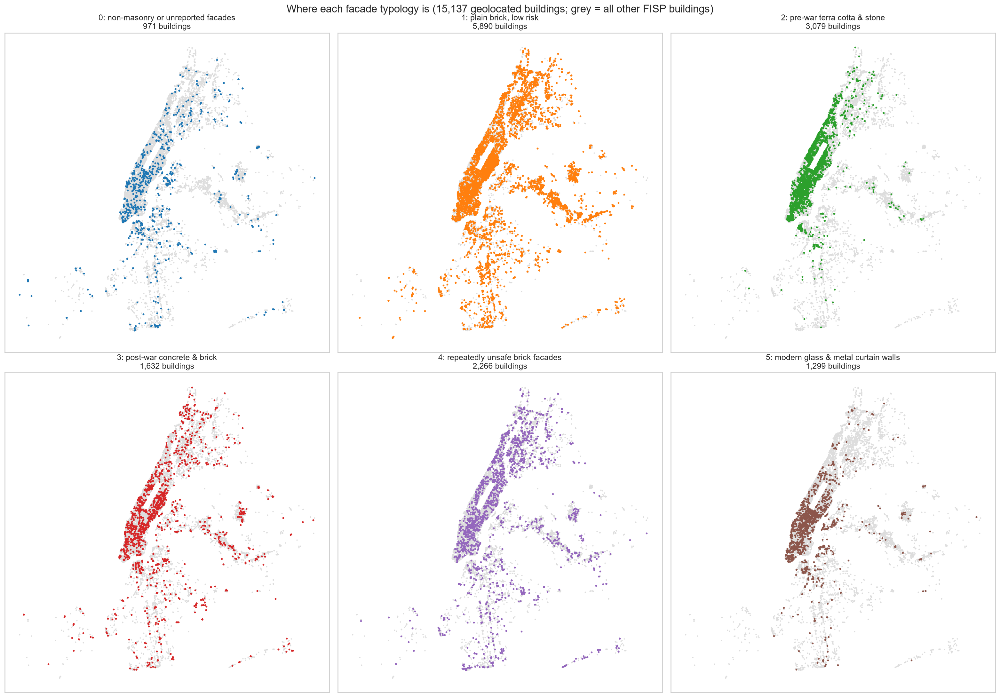
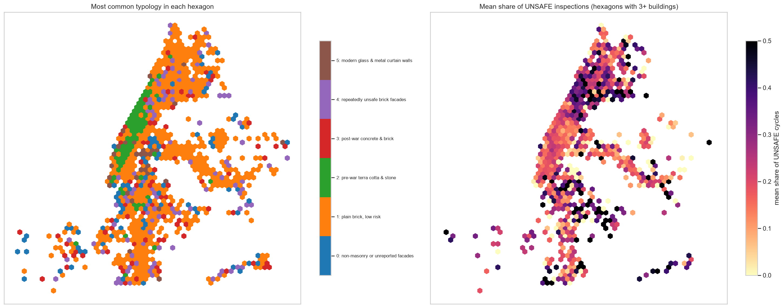
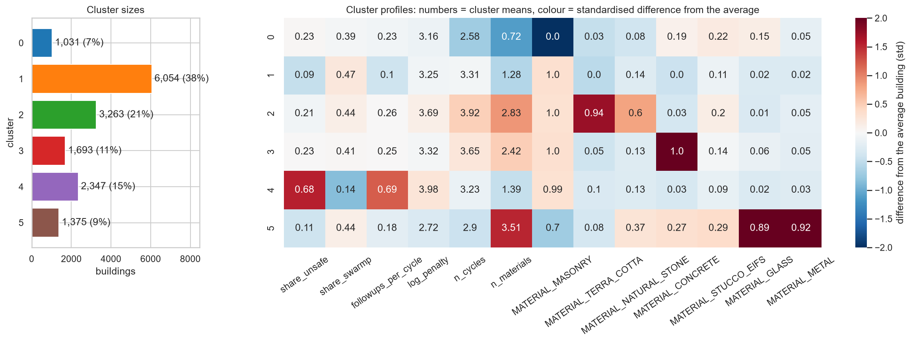
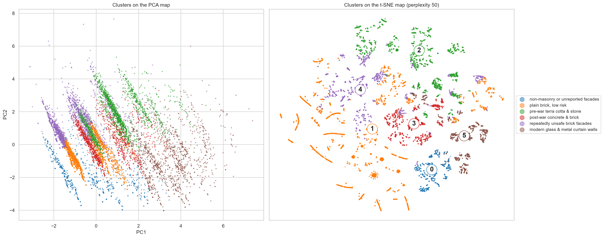

# NYC facade typologies: clustering FISP buildings by facade materials and inspection history

**Team:** Amelia, Jerome, Kazuko, Sahil
**Course:** AI Methods I – Day 3: Unsupervised learning (IAAC MaAI 2026/27)
**Dataset on Hugging Face:** https://huggingface.co/datasets/iaac-maai/day3-team1-nyc-facade-typologies
**Model on Hugging Face:** https://huggingface.co/iaac-maai/day3-team1-facade-typologies

## Use case

Every New York City building taller than 6 stories must have its facade inspected every 5 years (FISP, Local Law 11). On Day 2 we predicted
which inspections come out **UNSAFE**. Today we ask a different question: **which kinds of buildings exist in the FISP stock**, judged by what
their facades are made of and how they have behaved in inspections. The groups are meant for the **NYC Department of Buildings, facade
consultants and retrofit planners**, to organise **one programme per building type**. A terra-cotta pre-war building, a glass curtain wall and a
facade that is UNSAFE every cycle need different specialists, guidance or enforcement. A group is useful when we can **name** it, **find it on the
map**, and a **different action** makes sense for it.

## Dataset

| | |
|---|---|
| **Name** | DOB NOW: Safety – Facades Compliance Filings, cleaned in our Day 2 assignment, + PLUTO for location and building age |
| **Source** | [NYC Open Data, xubg-57si](https://data.cityofnewyork.us/d/xubg-57si) (filings) · [NYC Open Data, 64uk-42ks](https://data.cityofnewyork.us/d/64uk-42ks) (PLUTO) |
| **Our clustered version** | [iaac-maai/day3-team1-nyc-facade-typologies](https://huggingface.co/datasets/iaac-maai/day3-team1-nyc-facade-typologies) |
| **Rows used** | 67,659 cleaned filings → **15,763 buildings** (one row = one building) |
| **Coverage** | New York City, buildings taller than 6 stories, FISP cycles 6–10 (about 2004–2026), downloaded 2026-10-23 |
| **Licence** | NYC Open Data, free public use under the [NYC Terms of Use](https://www.nyc.gov/home/terms-of-use.page) |

The starting point is `data/facades_clean.csv`, the output of our Day 2 notebook
[`data_cleaning_and_EDA.ipynb`](https://github.com/iaac-maai/group1_day2_assignment/blob/main/notebook/data_cleaning_and_EDA.ipynb). It is committed
(15.5 MB), so this repository runs on its own. PLUTO is downloaded by the notebook (only 7 columns, cached in `data/`, not committed). The
published dataset contains **no street addresses or owner names**.

## Repository structure

```
├── data/
│   └── facades_clean.csv       # cleaned filings from our Day 2 assignment (input of the notebook)
├── dataset/                    # the main deliverable, as uploaded to Hugging Face
│   ├── README.md               # the dataset card
│   ├── *.png                   # figures shown in the dataset card
│   └── nyc_facade_typologies.csv   # the clustered buildings (not committed: on Hugging Face)
├── figures/                    # the 26 plots exported by the notebook
├── models/
│   ├── README.md               # the model card
│   ├── 19_cluster_profiles.png # figure shown in the model card
│   └── model.joblib            # the fitted pipeline (not committed: on Hugging Face)
├── notebook/
│   └── unsupervised_learning.ipynb   # the whole analysis, from filings to named clusters
├── .gitignore
├── LICENSE
├── README.md
└── requirements.txt            # pinned package versions
```

## How to run

```bash
python -m venv .venv
source .venv/bin/activate        # Windows: .venv\Scripts\activate
pip install -r requirements.txt
```

Open `notebook/unsupervised_learning.ipynb`, select the `.venv` kernel (we used **Python 3.14**) and run all cells. It needs an internet
connection the first time, to download PLUTO. It takes several minutes (t-SNE and the stability checks are the slow parts). It writes the figures
to `figures/`, the model to `models/model.joblib` and the clustered dataset to `dataset/nyc_facade_typologies.csv`.

To only use the results, load the dataset or the model from Hugging Face (see the cards for code).

## Approach

- **Unit of analysis:** one building (BIN). The filings of each building, one per 5-year cycle plus follow-ups, are aggregated into one row.
- **Features clustered on (13):** inspection record (`share_unsafe`, `share_swarmp`, `followups_per_cycle`, `log_penalty`), time in the
  programme (`n_cycles`) and facade materials (`n_materials` and 0/1 flags for masonry, terra cotta, natural stone, concrete, stucco / EIFS,
  glass, metal).
- **Kept aside for interpretation:** year built and number of floors (PLUTO), latitude / longitude and borough, wall types, the cycle in
  which the building entered FISP, latest status and penalty components.
- **Preprocessing:** `log10` of the penalties (very skewed), `StandardScaler` (the features have different units), inside a `Pipeline`.
- **Dimensionality reduction:** PCA (8 components for 80% of the variance, so there is no dominant direction) and t-SNE (perplexity 50, checked at 5 / 30 / 100).
- **Methods compared:** K-Means (k = 2–12), Ward hierarchical clustering and DBSCAN.
- **Final choice:** K-Means, k = 6, `n_init=50`. Ward has the same silhouette but merges the high-risk group into plain brick. DBSCAN breaks the
  data into 59 exact flag patterns. No k stands out in the elbow or silhouette curves (silhouette 0.17–0.20 for k = 3–12), so k = 6 is the largest
  stable k at which every group can be named.
- **Checks:**
  - stability: ARI 0.86 across seeds and 0.83 across 80% subsamples
  - agreement with Ward: ARI 0.45
  - profiles, radar charts, cross-tabulations with the variables kept aside
  - **maps of New York** for every group

## Results

| Cluster | Name | Size | Defining features |
|---|---|---|---|
| 0 | non-masonry or unreported facades | 1,031 (6.5%) | no masonry, 49% list no material at all; median year 1964. Partly a data-quality group |
| 1 | plain brick, low risk | 6,054 (38.4%) | brick only, share UNSAFE 0.09, few follow-ups; ~1955, 7 floors, all boroughs |
| 2 | pre-war terra cotta & stone | 3,263 (20.7%) | 94% terra cotta, 60% stone; **median year 1920, 88% Manhattan** |
| 3 | post-war concrete & brick | 1,693 (10.7%) | concrete + masonry, concrete / cavity walls; ~1964, 12 floors |
| 4 | repeatedly unsafe brick facades | 2,347 (14.9%) | **UNSAFE in 68% of inspections**, 69% UNSAFE today, median penalties 119,000 USD; Bronx and Upper Manhattan |
| 5 | modern glass & metal curtain walls | 1,375 (8.7%) | 89% glass, 92% metal; **median year 1997, 15 floors**, 77% Manhattan |

The year built, floors, borough and wall types were **not** used to build the clusters, and they confirm the names. The model separated a pre-war
group from a post-1990 group from the materials alone.









**Key findings:**

- **Materials carry history:** terra cotta is a pre-war Manhattan typology, glass and metal a post-1990 Midtown / Downtown / Long Island City one.
- **Risk cuts across materials:** 15% of buildings form a group defined by a bad record, not by a different facade. They are brick buildings like
  the low-risk majority, concentrated in the Bronx and Upper Manhattan.
- **Programmes follow:** a terra-cotta programme is a Manhattan programme, and enforcement on repeatedly unsafe facades should start in the Bronx and Upper Manhattan.

## Limitations

- **Soft structure:** silhouette 0.20; the groups are tendencies with fuzzy borders (especially plain brick / concrete / repeatedly unsafe),
  and no k is clearly optimal.
- **Self-reported materials:** inspectors tick boxes, and "other" is very common. Cluster 0 is partly defined by missing information.
- **Choice-dependent:** clustering on materials only (or using Ward) merges the repeatedly unsafe group into plain brick.
- **Coverage:** FISP buildings only (taller than 6 stories), cycles 6–10; 4% of buildings (mostly condominiums) could not be matched to PLUTO and are missing from the maps.
- **Not a safety tool:** the clusters do not predict the next inspection and are no engineering assessment; every facade still needs its inspection.

## AI usage disclosure

| | |
|---|---|
| **Tools** | Claude Code (Anthropic), running as an **agent** in VS Code: it read the brief and our Day 2 repository, wrote and ran code, and edited files in this repository |
| **Why** | To move fast from the brief to a complete, documented analysis, and to produce many figures and maps that would have taken us much longer to code by hand |
| **Where** | Notebook code (aggregation, PLUTO join, PCA, t-SNE, clustering, stability, all figures and maps), first drafts of the markdown interpretations, of the cluster names, of this README and of the model and dataset cards |
| **How** | We worked step by step. We gave the agent the brief's URL and asked it to check our Day 2 data, propose an approach, and then build the notebook section by section. Example prompt: *"finish the notebook, I want a lot of charts and graphs and visualisations and maps"*. We discussed the key choices in chat (unit of analysis, features clustered on vs kept aside, how the professor finds the data) and told it not to push anything without our approval. The agent ran the notebook end to end and looked at its own figures. That is how it caught a bug (a "share" of UNSAFE inspections above 1, because some buildings file several reports per cycle) and an unstable K-Means (fixed with `n_init=50`). We reviewed the cluster profiles, cross-tabs and maps and **checked every cluster name against them** |
| **Corrections** | The agent first pushed a draft notebook by mistake when we had asked for an empty one, and had to revert it. It proposed names and readings; we are responsible for them and checked them against the results |

**Lessons learned:**
- **Ask for one step at a time and read the result before moving on.** Explicit "don't push" instructions were necessary.
- **Agents are good at volume** (26 figures, cards, checks). The decisions are still ours: what "similar" means, which k, and what to call each group.
- **The most useful thing the agent did was look at its own charts.** A colour bar going up to 4 for a share revealed a real bug.

## License

Code and model released under the [MIT License](LICENSE). The data is subject to the [NYC Open Data Terms of Use](https://www.nyc.gov/home/terms-of-use.page)
(NYC Department of Buildings filings and NYC Department of City Planning PLUTO).
