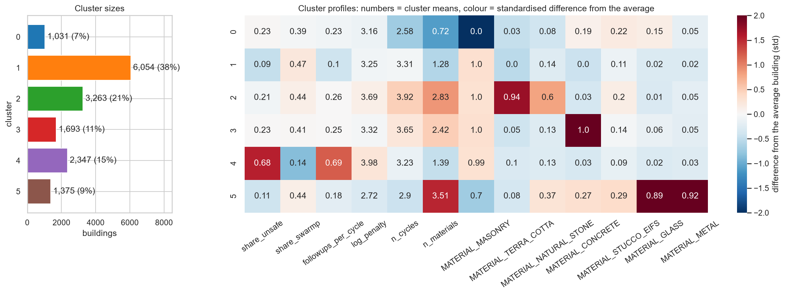

# NYC facade typologies: grouping FISP buildings by facade materials and inspection history

This model assigns a New York City building that is in the Facade Inspection & Safety Program (FISP, Local Law 11) to one of **six facade
typologies**, based on **what its facade is made of** and **how it has behaved in its 5-yearly inspections**. It is meant for the NYC
Department of Buildings (DOB), facade consultants and retrofit planners, to organise **one programme per building type** (inspection guidance,
repair specifications, enforcement). It is a scikit-learn pipeline (`StandardScaler` + `KMeans`, k = 6) fitted on 15,763 buildings. It was built
as a course assignment for AI Methods I (IAAC MaAI 2026/27).

- **GitHub repository (full analysis):** https://github.com/iaac-maai/group1_day3_assignment
- **Clustered dataset:** https://huggingface.co/datasets/iaac-maai/day3-team1-nyc-facade-typologies
- **Team:** Amelia, Jerome, Kazuko, Sahil

## Intended use

- **Intended users and use:** DOB facade staff, facade engineers and retrofit planners who want to place a FISP building in a typology. Examples:
  group a portfolio by facade type, pick the buildings for a terra-cotta or curtain-wall programme, or list the repeatedly unsafe buildings for
  enforcement.
- **Out-of-scope uses:**
  - **Predicting the next inspection.** The clusters describe the past; for that question see our Day 2 model.
  - **Any engineering or safety judgement** on a facade. A "low risk" building still needs its inspection.
  - **Buildings outside FISP** (6 stories or lower), outside New York City, or with a facade history outside cycles 6–10.
  - **Buildings with no inspection history.** The model needs at least one initial FISP report to compute the shares.

## Model details

| | |
|---|---|
| **Task** | Clustering (unsupervised) |
| **Algorithm** | `KMeans` |
| **Key hyperparameters** | `n_clusters=6`, `n_init=50`, `random_state=42` |
| **Preprocessing** | `StandardScaler` on the 13 inputs (inside the pipeline); `log_penalty` is already `log10(total penalty + 1)` |
| **Assigner** | Not needed: K-Means assigns new buildings with `.predict()` (nearest centroid) |
| **File** | `model.joblib`: the whole fitted scikit-learn `Pipeline` |
| **Library versions** | Python 3.14.6, scikit-learn 1.9.1, pandas 3.1.0, numpy 2.5.4, joblib 1.6.0 |
| **Authors** | Amelia, Jerome, Kazuko, Sahil |

## Input features

The model expects a `pandas.DataFrame` with exactly these 13 columns, in this order. They describe one building, computed from all its FISP filings:

| Column | Type | Unit | Description | Preprocessing |
|---|---|---|---|---|
| `share_unsafe` | numeric | 0–1 | Share of the building's initial reports that were UNSAFE | scaling |
| `share_swarmp` | numeric | 0–1 | Share of initial reports that were SWARMP (safe with repair and maintenance programme) | scaling |
| `followups_per_cycle` | numeric | filings / cycle | Amended + subsequent filings divided by the number of cycles | scaling |
| `log_penalty` | numeric | log10 USD | `log10(total FISP penalties in USD + 1)` | scaling |
| `n_cycles` | numeric | cycles | FISP cycles with an initial report (1–5) | scaling |
| `n_materials` | numeric | – | Number of facade materials listed, excluding "other" (0–7) | scaling |
| `MATERIAL_MASONRY` | 0/1 | – | Masonry listed in any report | scaling |
| `MATERIAL_TERRA_COTTA` | 0/1 | – | Terra cotta listed | scaling |
| `MATERIAL_NATURAL_STONE` | 0/1 | – | Natural stone listed | scaling |
| `MATERIAL_CONCRETE` | 0/1 | – | Concrete listed | scaling |
| `MATERIAL_STUCCO_EIFS` | 0/1 | – | Stucco / EIFS listed | scaling |
| `MATERIAL_GLASS` | 0/1 | – | Glass listed | scaling |
| `MATERIAL_METAL` | 0/1 | – | Metal listed | scaling |

## Output and clusters

`model.predict(X)` returns the cluster number of each row (0–5):

| Cluster | Name | Share of the data | Defining features |
|---|---|---|---|
| 0 | non-masonry or unreported facades | 6.5% | No masonry, 49% list no material; median year 1964. Weakest group, partly a data-quality group |
| 1 | plain brick, low risk | 38.4% | Brick only, share UNSAFE 0.09, few follow-ups; ~1955, 7 floors, all boroughs |
| 2 | pre-war terra cotta & stone | 20.7% | 94% terra cotta, 60% stone; median year 1920, 88% Manhattan |
| 3 | post-war concrete & brick | 10.7% | Concrete + masonry; ~1964, 12 floors |
| 4 | repeatedly unsafe brick facades | 14.9% | Share UNSAFE 0.68, 0.69 follow-ups per cycle, median penalties 119,000 USD; Bronx and Upper Manhattan |
| 5 | modern glass & metal curtain walls | 8.7% | 89% glass, 92% metal; median year 1997, 15 floors, 77% Manhattan |

Year built, floors and borough were **not** inputs. They come from PLUTO and confirm the names.



## Training data

| | |
|---|---|
| **Dataset** | DOB NOW: Safety – Facades Compliance Filings (NYC Department of Buildings) |
| **Source** | [original](https://data.cityofnewyork.us/d/xubg-57si) · [our clustered version](https://huggingface.co/datasets/iaac-maai/day3-team1-nyc-facade-typologies) |
| **Licence** | NYC Open Data, [NYC Terms of Use](https://www.nyc.gov/home/terms-of-use.page) (free public use) |
| **One row is** | one building (BIN), aggregated from its filings |
| **Size used** | 15,763 buildings (from 67,659 cleaned filings) |
| **Coverage** | New York City, buildings taller than 6 stories, FISP cycles 6–10 (about 2004–2026), downloaded 2026-10-23 |

**Cleaning and feature engineering:** the filings were cleaned in our Day 2 notebook (87,483 → 67,659 filings) and aggregated per building:
shares of UNSAFE / SWARMP initial reports, follow-up filings per cycle, log of total penalties, number of cycles, and every material ever
listed (0/1). Buildings without a block / lot (4) were dropped.

## Method and evaluation

- **Methods compared:**
  - **K-Means**, k = 2–12.
  - **Ward hierarchical clustering**, k = 6, on a 4,000-building sample, extended to all buildings with 5-nearest neighbours. ARI with K-Means: **0.45**.
    Ward finds the same material groups but merges the repeatedly unsafe group into plain brick.
  - **DBSCAN** (eps from the k-distance plot). It returns 59 clusters for one exact flag pattern after another, plus 9% noise, so it does not suit this data. ARI with K-Means: 0.42.
- **Choice of k:**
  - **Elbow:** no clear one.
  - **Silhouette:** 0.31 at k = 2 (it only separates glass buildings), then flat at 0.17–0.20 for k = 3–12.
  - **Decision:** k = 6 is the largest k that stays stable and gives groups that can all be named. Silhouette at k = 6: **0.20**.
- **Stability:** mean ARI **0.86** over 10 random seeds (minimum 0.80) and **0.83** over 10 subsamples of 80% (minimum 0.81).
  With the default `n_init=10`, seeds sometimes ended in different local optima (ARI as low as 0.50), hence `n_init=50`.
- **Why this model:** same silhouette as Ward, but it keeps a separate high-risk group (the most actionable one), predicts new buildings directly, and is stable.

## Limitations and biases

- **Soft structure:** a silhouette of 0.20 means the groups overlap; many buildings sit near a border, especially between plain brick, concrete
  & brick and repeatedly unsafe. Treat the labels as tendencies.
- **Self-reported materials:** inspectors tick materials, and "other" is common. Cluster 0 is partly defined by what is **not** reported.
- **Choice-dependent:** different features (for example materials only) or a different k give different groups.
- **History-dependent:** a building's cluster can change as new cycles add reports, especially the risk-based cluster 4.
- **Bias of the stock:** 57% of the buildings are in Manhattan and most were built before 1970. Typologies that are rare in FISP may be absorbed by larger groups.

## How to use

```python
import joblib
import numpy as np
import pandas as pd
from huggingface_hub import hf_hub_download

path = hf_hub_download(repo_id="iaac-maai/day3-team1-facade-typologies", filename="model.joblib")
model = joblib.load(path)

CLUSTER_NAMES = {
    0: "non-masonry or unreported facades",
    1: "plain brick, low risk",
    2: "pre-war terra cotta & stone",
    3: "post-war concrete & brick",
    4: "repeatedly unsafe brick facades",
    5: "modern glass & metal curtain walls",
}

# a pre-war brick building with terra-cotta and stone ornament, 4 cycles, never UNSAFE, 15,000 USD of penalties
example = pd.DataFrame([{
    "share_unsafe": 0.0, "share_swarmp": 0.5, "followups_per_cycle": 0.25, "log_penalty": np.log10(15000 + 1),
    "n_cycles": 4, "n_materials": 3,
    "MATERIAL_MASONRY": 1, "MATERIAL_TERRA_COTTA": 1, "MATERIAL_NATURAL_STONE": 1, "MATERIAL_CONCRETE": 0,
    "MATERIAL_STUCCO_EIFS": 0, "MATERIAL_GLASS": 0, "MATERIAL_METAL": 0,
}])
cluster = int(model.predict(example)[0])
print(cluster, CLUSTER_NAMES[cluster])   # 2 pre-war terra cotta & stone
```

⚠️ `.joblib` files are Python pickles and can execute code when loaded: only load models from sources you trust. Use the library versions
listed above; the model may not load with other versions of scikit-learn.

## Reproducibility

The full analysis (aggregation, PLUTO join, PCA, t-SNE, clustering, stability, interpretation, export) is in the GitHub repository:
https://github.com/iaac-maai/group1_day3_assignment. Run `notebook/unsupervised_learning.ipynb` with the packages in `requirements.txt`
(Python 3.14). Every random step uses `random_state=42`.

## Authors and licence

Amelia, Jerome, Kazuko, Sahil. Course assignment for **AI Methods I: Machine Learning for the Built Environment**, IAAC MaAI 2026/27.

Model released under the MIT License. The training data is subject to the [NYC Open Data Terms of Use](https://www.nyc.gov/home/terms-of-use.page)
(NYC Department of Buildings, DOB NOW: Safety – Facades Compliance Filings).
